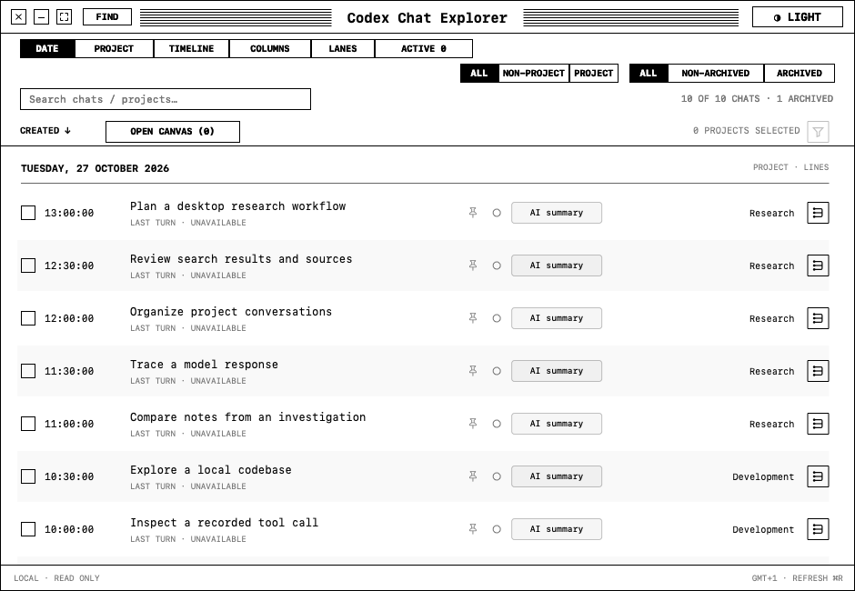

# Codex Chat Explorer

A native macOS app for browsing local Codex chat history. Explore conversations by date or project, read recorded messages, search passages, and arrange chats on a canvas. Source chats remain read-only.



## What you can do

- Browse six views: **Date**, **Project**, **Timeline**, **Columns**, **Lanes**, and **Active**. Filter by project or archive status, and open a chat to read its recorded history.
- Search titles, projects, and saved labels. Search message passages by exact words or, optionally, local semantic similarity. Results link back to recorded passages; the app does not generate answers.
- Save excerpts, star or pin chats, and add colored tags. Optionally request a short AI summary for an individual chat; this is an app-owned annotation and does not rename the source chat.
- Arrange chats and Explorer views on saved canvases, open multiple windows, and move views between a canvas and the desktop.

## Requirements and build

- macOS 13 or later and a Swift 5.9-compatible toolchain.
- Local Codex data in `~/.codex`, or the directory specified by `CODEX_HOME`. Availability and behavior depend on the locally installed Codex data formats.

From a checkout, build an ad-hoc signed app and run the tests:

```sh
./scripts/build-app.sh
swift test
open "dist/Codex Chat Explorer.app"
```

The build script creates a local app bundle without a developer certificate; it does not install, notarize, or distribute the app. Move or remove an existing `dist/Codex Chat Explorer.app` before rebuilding. This source snapshot uses a separate bundle identifier. Canvas Markdown displays diagram and math source without rendered diagrams, typeset math, or syntax highlighting; the third-party rendering bundles are omitted pending notice review.

## Search and summaries

**Find → Messages** offers Exact, Meaning, and Combined search. Start or resume indexing explicitly to build the local search index. Text coverage and vector coverage can differ while indexing is underway; missing or unreadable records are reported. Indexing runs only while Explorer is open, with progress and Pause/Cancel controls. Turning semantic search off stops its model work while retaining the index; Exact search remains available for imported text.

Meaning search requires Ollama at `/usr/local/bin/ollama` or `/opt/homebrew/bin/ollama`, and the pinned `qwen3-embedding:8b` model under `~/Local AI Models/ollama`. The embedding manifest must have SHA-256 `64b933495768fbd3b87c20583d379728a07471e0c66733a9df87cd1901b3c44b`; other manifest digests are rejected. Optional reranking requires `llama-server` at `/opt/homebrew/bin/llama-server` and the expected Qwen3-Reranker-8B GGUF file at `~/Local AI Models/Qwen3-Reranker-8B/Qwen3-Reranker-8B-Q4_K_M.gguf`. The expected reranker file is the Q4_K_M conversion from [DevQuasar/Qwen.Qwen3-Reranker-8B-GGUF](https://huggingface.co/DevQuasar/Qwen.Qwen3-Reranker-8B-GGUF), revision `5da2d265a7e19af31377fac508d01ff842658f67`, with SHA-256 `3ed339da6ff655f1d262c41aab1348536684007fb984bcde929650ee6986dc5a`. Models and runtimes are not bundled or automatically downloaded. Indexing can take hours and requires substantial memory and disk space; model compatibility depends on the exact expected weights and runtime features.

Short summaries are requested one chat at a time. The local option requires `qwen3.6` under `~/Local AI Models/ollama` and Ollama; an explicitly chosen Codex/Luna option uses the authenticated Codex runtime and sends the sampled excerpts to that provider. Browsing, refreshing, and changing tags do not request summaries. Local search and local summaries use private local model processes; they do not modify the shared Ollama service.

## Data and privacy

Explorer reads local Codex databases and selected rollout files. SQLite sources are opened read-only, and the app does not edit or invoke the chats it displays. It stores its own annotations, canvas layouts, search index, and local diagnostic records under `~/Library/Application Support/CodexChatExplorer`; preferences are stored separately in the macOS preferences domain. The model runtime also uses `~/Library/Application Support/Codex Chat Explorer/SemanticSearch/Runtime`. The index can contain captured message text and source metadata, so treat the application-support directory as sensitive.

Local diagnostics record operational metadata such as navigation, identifiers, timing, and resource measurements; they exclude transcript text, titles, search text, and credentials. They stay on the machine unless you export or share them. Record identifiers may still link to personal conversations.

## Scope and limitations

The reader and search cover recorded local data, not a complete archive of every tool event, attachment, provider request, or upstream conversation. Search does not recover encrypted reasoning or attachment pixels. Large or unavailable sources may be deferred or reported as partial. Original files remain authoritative.

**Active** observes the local desktop's lifecycle interface; it does not claim coverage of remote, cloud-only, or CLI-only activity. Codex's local formats and lifecycle interface may change, so compatibility with future versions is not guaranteed. No background collector is installed.
